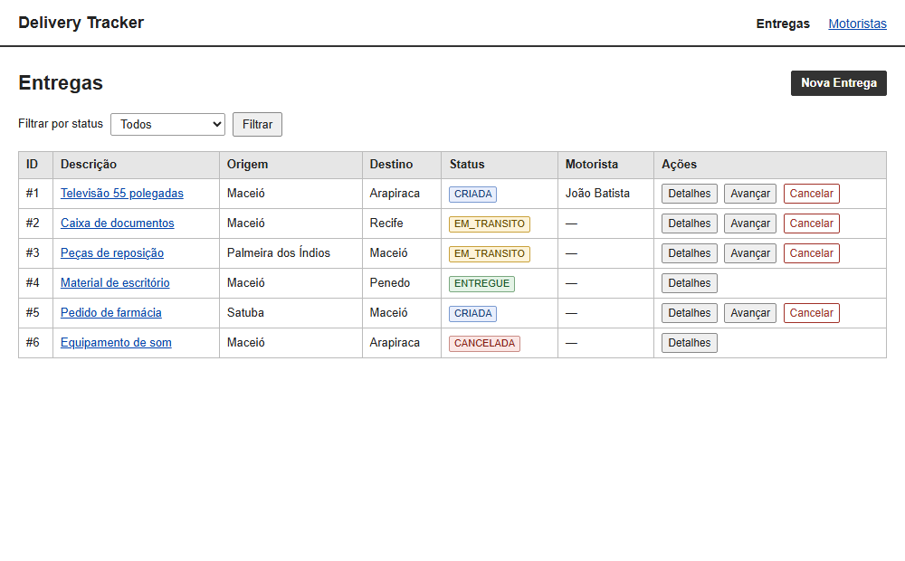

# Delivery Tracker — Interface Web SSR (EJS)

Sistema de rastreamento do ciclo de vida de encomendas com interface web renderizada no servidor, desenvolvido para a disciplina de **Programação Web II — IFAL Maceió**.

A persistência continua a cargo do **Prisma ORM** sobre **SQLite**, e as regras de negócio seguem nos `services` e `repositories` — a mudança desta etapa está na camada de apresentação, que passou de API JSON para páginas HTML com **EJS**, layout, partials, formulários e mensagens flash.

## Tecnologias

- Node.js + Express
- EJS + express-ejs-layouts (SSR com layout e partials)
- express-session + connect-flash (mensagens entre redirecionamentos)
- method-override (PATCH a partir de formulários HTML)
- express-validator (validação de formulários)
- Prisma + SQLite

## Como Executar

### 1. Instalar as dependências

```bash
npm install
```

### 2. Configurar o ambiente

```bash
cp .env.example .env
```

O `.env` define a conexão com o banco (SQLite):

```text
DATABASE_URL="file:./dev.db"
```

### 3. Aplicar as migrations

```bash
npx prisma migrate dev
```

Isso cria o banco `prisma/dev.db` e aplica as migrations versionadas de `prisma/migrations/`.
Em um ambiente já migrado (como o CI), use `npx prisma migrate deploy`.

### 4. Iniciar o servidor

```bash
npm start
```

Ou, com recarga automática durante o desenvolvimento:

```bash
npm run dev
```

A aplicação será executada, por padrão, em:

```text
http://localhost:3000
```

O servidor respeita `process.env.PORT`.

### 5. Inspecionar os dados

```bash
npx prisma studio
```

## Telas

### Entregas



A listagem traz a tabela de entregas, filtro por status, badge de status e ações rápidas de avançar/cancelar.

### Demais telas

- `/entregas/nova` — formulário de criação de entrega
- `/entregas/:id` — detalhe com status, motorista, ações e histórico de eventos
- `/motoristas` — listagem de motoristas
- `/motoristas/novo` — formulário de cadastro de motorista

## Contrato de Rotas (SSR)

| Método | Caminho | Comportamento |
|---|---|---|
| GET | `/` | Redireciona para `/entregas` |
| GET | `/entregas` | Listagem com filtro opcional por `?status=` |
| GET | `/entregas/nova` | Formulário de nova entrega |
| POST | `/entregas` | Cria a entrega e redireciona (PRG); inválida → form com erros (400) |
| GET | `/entregas/:id` | Detalhe com status e histórico; inexistente → página 404 |
| PATCH | `/entregas/:id/avancar` | Avança o status e redireciona |
| PATCH | `/entregas/:id/cancelar` | Cancela a entrega e redireciona |
| PATCH | `/entregas/:id/atribuir` | Atribui um motorista (`motoristaId`) e redireciona |
| GET | `/motoristas` | Listagem de motoristas |
| GET | `/motoristas/novo` | Formulário de cadastro |
| POST | `/motoristas` | Cria o motorista e redireciona; CPF duplicado → form com erro |

As ações de estado são `PATCH`, disparadas por formulários HTML com `method-override`:

```html
<form method="POST" action="/entregas/1/avancar?_method=PATCH">
  <input type="hidden" name="_method" value="PATCH">
  <button type="submit">Avançar status</button>
</form>
```

O endpoint `GET /api/health` permanece apenas como verificação de que o servidor subiu:

```bash
curl -X GET http://localhost:3000/api/health
```

Resposta:

```json
{ "status": "ok" }
```

## Regras de Negócio

As regras do Cap. 4/5 continuam valendo e agora são exibidas como mensagem na tela:

- origem e destino não podem ser iguais;
- não é permitido cadastrar entrega duplicada com a mesma descrição/origem/destino enquanto houver uma entrega ativa;
- ciclo de status: `CRIADA → EM_TRANSITO → ENTREGUE`; entregas `ENTREGUE` ou `CANCELADA` não avançam nem são canceladas;
- motorista só pode ser atribuído a entrega com status `CRIADA`, e precisa estar `ATIVO`;
- CPF de motorista é único.

## Estrutura

```text
server.js                     configuração do Express, EJS, sessão, flash e method-override
src/controllers/              controllers que renderizam views e aplicam PRG
src/routes/                   rotas web de entregas e motoristas
src/middlewares/validators.js validações de formulário (express-validator)
src/services/                 regras de negócio (inalteradas)
src/repositories/             acesso a dados via Prisma (inalterado)
src/views/layouts/            layout base
src/views/partials/           navbar, flash e bloco de erros
src/views/entregas/           listagem, formulário e detalhe
src/views/motoristas/         listagem e formulário
src/views/erros/              páginas 404 e 500
public/css/                   estilos
prisma/                       schema e migrations
```
